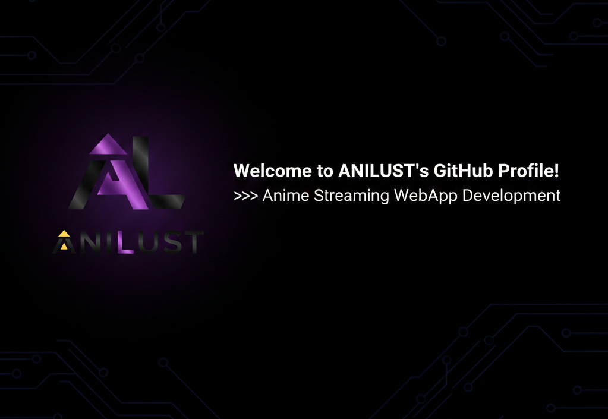
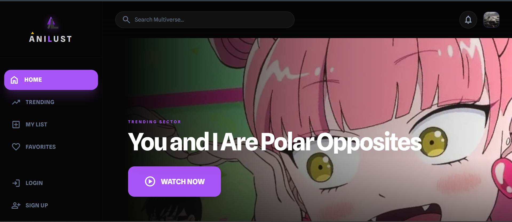

# <p align="center">📺 AniLust 📺</p>

<p align="center">
  
</p>

<p align="center">
  
  
  
</p>

<p align="center">
  <a href="https://TejasRajkumarS.github.io/AniLust">
    
  </a>
</p>

---

## 📖 About AniLust

**AniLust** is a high-performance anime discovery platform built for the modern anime community.

Designed with a focus on **minimaist UX**, **real-time data fetching**, and a **cinema-first interface**, AniLust provides a centralized hub for discovering, searching, and managing anime titles.

The application combines AniList metadata with a modern React interface, intelligent search, personalized libraries, AI-powered insights, and optional streaming support.

---

## ✨ Features

### 🌟 Intelligent Discovery

- **Trending Sector** — Discover popular and currently trending anime titles.
- **Search Multiverse** — Quickly search anime titles without page reloads.
- **Detailed Anime Pages** — View genres, ratings, status, descriptions, characters, and other metadata.
- **Real-time Data** — Anime information is dynamically fetched through APIs.

### 🎨 Premium UI/UX

- **Glassmorphism Sidebar** — Modern navigation with frosted-glass styling.
- **Responsive Grid** — Designed to work across mobile, tablet, laptop, and desktop screens.
- **Cinema-First Interface** — Large artwork and clean layouts keep the focus on anime.
- **Smooth Interactions** — Modern transitions and interactive UI components.
- **Dark Mode Experience** — A cinematic dark interface with vibrant purple accents.

### 🤖 AI Features

- **AI Anime Insights** — Optional Gemini-powered insights for anime pages.
- **Smart Recommendations** — AI functionality can be extended to provide personalized recommendations.

### 🔐 User Ecosystem

- **My List** — Save anime for later.
- **Favorites** — Keep track of favorite titles.
- **Authentication Suite** — Login and signup modules are included for future backend integration.

### ▶️ Streaming Support

- Episode lists and video streams can be provided through a self-hosted **aniwatch-api** instance.
- Anime metadata continues to work independently through AniList.
- Streaming is optional and requires the streaming API configuration described below.

---

## 📸 Interface Preview

<p align="center">
  
</p>

---

## 🛠 Tech Stack


### Core Technologies

- **React**
- **Vite**
- **TypeScript / JavaScript**
- **Tailwind CSS**
- **Three.js**
- **Firebase**
- **AniList GraphQL API**
- **Google Gemini API**
- **aniwatch-api**

---

## 🏗️ Technical Architecture

This project demonstrates modern frontend engineering principles:

### API Management

Uses the **AniList GraphQL API** to retrieve complex nested anime data including:

- Genres
- Ratings
- Status
- Descriptions
- Characters
- Cover images
- Trending information

### State Management

Application state is managed through React state and application-level services to keep the frontend lightweight and responsive.

### Visual Assets

Dynamic rendering is used for anime cover images and other media to maintain a fast and visually rich experience.

### Streaming Architecture

Streaming functionality is separated from the anime metadata layer. AniList provides anime information while a self-hosted aniwatch-api instance provides episode and streaming data.

---

# 🚀 Getting Started

## Prerequisites

Before running AniLust locally, make sure you have:

- **Node.js 18+** — [Download Node.js](https://nodejs.org/)
- A self-hosted **aniwatch-api** instance — required for episodes and streaming
- A **Gemini API Key** — optional, only required for AI insights

---

## 📦 Installation

### 1. Clone the Repository

```bash
git clone https://github.com/tejasrajkumars/AniLust.git
cd AniLust
```

### 2. Quick Setup — Windows

```bash
setup-dev.bat
```

### 3. Quick Setup — macOS/Linux

```bash
chmod +x setup-dev.sh
./setup-dev.sh
```

---

## 🔧 Manual Setup

### Frontend Setup

```bash
npm install
cp .env.example .env
```

Edit the `.env` file and configure the required variables:

```env
VITE_HIANIME_API_URL=https://your-aniwatch-api-url
VITE_BACKEND_URL=http://localhost:5000
VITE_GEMINI_API_KEY=your_api_key_here
```

Then start the frontend:

```bash
npm run dev
```

The development server runs on:

```text
http://localhost:3000
```

---

## 🖥️ Backend Setup

The backend is optional and can be used as an AniList proxy.

```bash
cd server
npm install
cp .env.example .env
```

Configure the backend environment variables if required, then run:

```bash
npm run dev
```

The backend runs on:

```text
http://localhost:5000
```

---

# 🎬 Streaming Backend

AniLust uses a self-hosted **aniwatch-api** instance for episode lists and video streams.

The public streaming APIs previously used by many anime applications are no longer reliable, so a self-hosted instance is recommended.

### 1. Deploy an aniwatch-api instance

Fork or clone:

```text
https://github.com/ghoshRitesh12/aniwatch-api
```

You can deploy it using a suitable hosting provider such as:

- Render
- Railway
- Vercel
- VPS

Follow the deployment instructions provided by the aniwatch-api project.

### 2. Configure AniLust

Add your deployed API URL to `.env`:

```env
VITE_HIANIME_API_URL=https://your-aniwatch-api.onrender.com
```

### 3. Restart the development server

```bash
npm run dev
```

Without this configuration:

- Browsing works
- Searching works
- AniList metadata works
- Anime details work
- **Video playback will not be available**

---

# 🔑 Environment Variables

Create a `.env` file in the project root:

```env
# Self-hosted aniwatch-api
# Required for episodes and streaming
VITE_HIANIME_API_URL=

# Optional AniList proxy backend
VITE_BACKEND_URL=http://localhost:5000

# Optional Google Gemini API key
# Used for AI-powered anime insights
VITE_GEMINI_API_KEY=
```

> Never commit your `.env` file or expose private API keys in your repository.

---

# 🚀 Deployment

AniLust can be deployed as a frontend application using services that support Vite/React applications.

For the optional backend, see:

```text
server/DEPLOYMENT.md
```

The streaming backend should be deployed separately using the deployment instructions provided by the aniwatch-api project.

---

# 🛠️ Troubleshooting

## "No streaming sources found"

1. Confirm `VITE_HIANIME_API_URL` is configured in `.env`.
2. Make sure the API instance is online.
3. Restart the frontend after changing `.env`.
4. Test the API endpoint:

```bash
curl https://your-aniwatch-api/api/v2/hianime/search?q=naruto
```

If the server returns `503`, the hosting provider may be waking up a sleeping free-tier instance. Wait approximately 30 seconds and try again.

---

## "CORS Error"

If you are using the optional backend, make sure:

```env
FRONTEND_URL=http://localhost:3000
```

matches the actual frontend origin.

---

# 📁 Project Structure

```text
anilust/
├── server/
│   ├── index.js
│   ├── DEPLOYMENT.md
│   └── README.md
│
├── src/
│   ├── components/
│   │   ├── AnimeCard
│   │   ├── Logo
│   │   └── Sidebar
│   │
│   ├── pages/
│   │   ├── Home
│   │   ├── Trending
│   │   ├── AnimeDetails
│   │   ├── Watch
│   │   ├── Watchlist
│   │   ├── Favorites
│   │   ├── Login
│   │   └── Signup
│   │
│   ├── services/
│   │   ├── consumet.ts
│   │   └── gemini.ts
│   │
│   ├── utils/
│   │   ├── auth.ts
│   │   └── validation.ts
│   │
│   └── App.tsx
│
├── vite.config.ts
├── tsconfig.json
├── .env.example
└── README.md
```

---

# 🌐 Live Demo

<p align="center">
  <a href="https://TejasRajkumarS.github.io/AniLust">
    
  </a>
</p>

**Live Website:**  
https://TejasRajkumarS.github.io/AniLust

---

# 📊 Project Highlights

- ⚡ Fast Vite-powered frontend
- 🎨 Modern cinematic UI
- 📱 Responsive design
- 🔎 Real-time anime discovery
- 📚 Personalized watchlists and favorites
- 🤖 Optional Gemini AI integration
- 🎬 Optional anime streaming integration
- 🌐 AniList GraphQL integration
- 🔐 Authentication-ready architecture

---

# 📄 License

This project is licensed under the **MIT License**.

See the `LICENSE` file for more information.

---

<p align="center">
  Made with ❤️ for anime fans.
</p>
